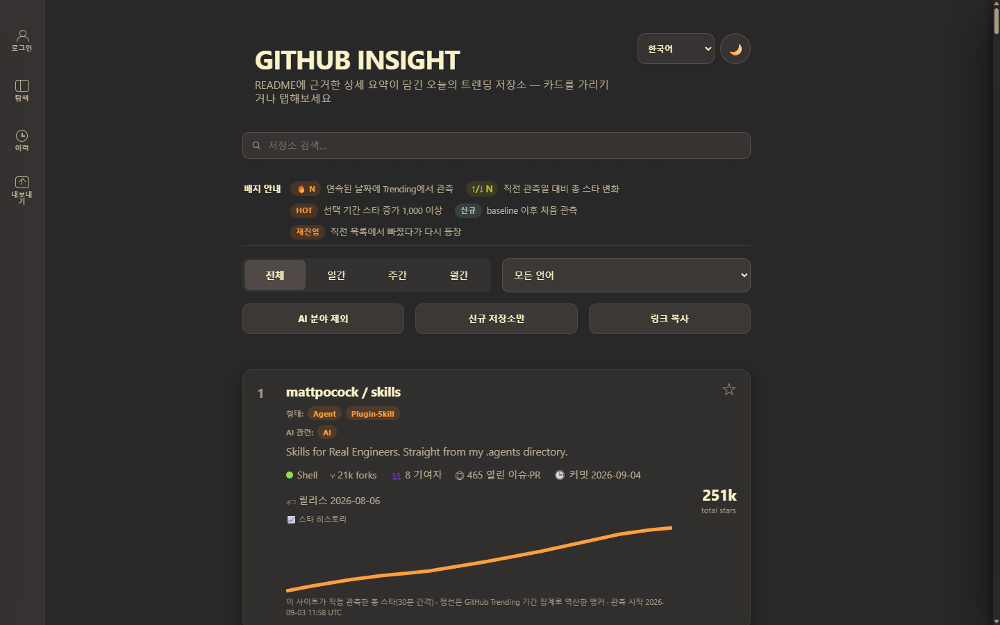
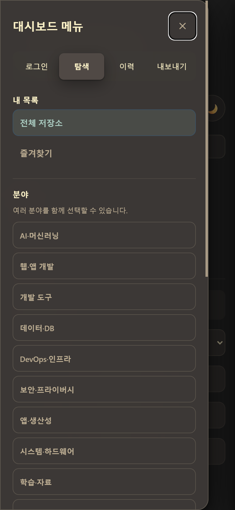

# GITHUB INSIGHT

[한국어](README.ko.md) · [Open the dashboard](https://nowwcastle-sudo.github.io/github-trending-daily/) · [English](README.en.md)

A static dashboard for exploring GitHub Trending through README-based summaries, repository activity, and star history. Browsing needs no account. Optional Google sign-in synchronizes favorites.

## Explore repositories

Choose daily, weekly, monthly, or combined Trending. Search and combine programming language, field, form, technology, favorites, AI exclusion, and new-repository filters. Choices within a group use OR; different groups use AND.

| View | Membership and Trending order | Period metrics |
| --- | --- | --- |
| Daily, weekly, monthly | Valid membership in the selected period; sorted by its rank | Selected-period gain, HOT, sparkline |
| Combined | Union of the three lists; original source order | Total stars and separately labeled daily gain; no combined-period gain, HOT, or sparkline |

A missing gain remains missing; a reported zero remains zero. HOT means a reported gain of at least 1,000 in the selected period. Combined is not a separate GitHub ranking. Other sorting options cover period gain, total stars, latest push, and latest release. GitHub's open-issue count includes pull requests.

## Summaries and upstream README

Hover or focus a desktop card, or tap a mobile card, to open its summary. The header selects the UI and summary language: English, Korean, Simplified Chinese, Spanish, or Japanese.

| Field | Content |
| --- | --- |
| `goal` | What the repository does |
| `usage` | Source-backed installation and usage |
| `pros` | Source-backed strengths |
| `cons` | Limits, with inference qualified |
| `fit` | Suitable users and use cases |

**README variants from upstream only.** **View README** displays the canonical source and only language variants that actually exist upstream. README path, default-branch head, blob SHA, and content SHA-256 bind the source. The project does not generate or store full README translations.

Summaries are AI-generated and automatically checked, not human-reviewed recommendations. Verify upstream instructions and security requirements before installing a featured project.

## Summary admission

Repository and README collection precede generation. All five languages form one atomic bundle. Fields keep distinct roles; installation and execution commands belong in `usage`. English allows 100–280 words. Other locales need not match English phrasing, sentence count, or information order.

Only one or two central commands appearing in the README may be quoted. Commands and other immutable tokens must remain source-backed and in the corresponding field across locales. Generic “see the README” deferrals are invalid. Up to three corrections follow the initial attempt.

The semantic quality judge currently checks English. Other locales receive schema, phrase, and cross-locale invariant checks; that does not amount to semantic review of all five languages.

| Status | Meaning |
| --- | --- |
| `verified` | Generated and accepted in the current run |
| `retained` | An existing bundle passed current reuse checks |
| `held` | Collected metrics remain; a localized verification notice replaces the summary |

Held repositories are reconsidered on later refreshes. Classification failure also holds a repository's summary. One held repository does not alone fail the refresh. **More than 50% held, or no verified/retained summary, rejects the complete candidate.** Collection, provenance, and artifact failures can also stop publication.

## Stars and history

| Metric | Source and interpretation |
| --- | --- |
| Total stars | Direct GitHub repository API observations |
| Daily, weekly, monthly gain | GitHub Trending's reported period counts |
| Solid history line | This site's recorded observations |
| Dashed line with hollow markers | Approximate anchors back-calculated from Trending gains where observations are missing |

Published repositories are scheduled for observation at UTC minute 13 and 43 each hour. Previously published repositories also enter an archive tier, observed at most once per UTC day within a 500-repository cap selected by seven-day gain. Runs can be delayed, skipped for rate-limit reserve, or blocked by another run. Two successful observations no more than 36 hours apart can form a solid line; longer gaps stay disconnected. A fixed time until a full-day curve is not guaranteed.

GH Archive / OSS Insight event-derived historical estimates were discontinued on 2026-09-02 after the upstream source disclosed severe degradation.

Membership history distinguishes baseline presence, first appearance after baseline, and re-entry after absence. The “new since your last visit” signal compares with this browser's previous visit and is separate from shared membership history.

## Navigation, favorites, and export

| Rail group | Controls |
| --- | --- |
| Login | Google sign-in and favorites synchronization |
| Explore | Filters, sorting, saved presets |
| History | Hidden-repository recovery and membership changes |
| Export | Current-view CSV/JSON and shareable discovery URL |

Desktop hover opens a passive sidebar; clicking or keyboard activation opens a focus-trapped panel. Mobile supports edge swipes. Light/dark themes, compact list mode, reduced motion, and reduced transparency are supported.

Favorites work locally when signed out. **Not interested** hides a repository in this browser, supports undo/recovery, and does not remove its favorite. Up to 20 named, saved filter presets are stored locally.

| Shortcut | Action |
| --- | --- |
| `/`, `?`, `Escape` | Search, shortcut help, close |
| `a`, `e`, `h`, `x` | Login, Explore, History, Export |
| `Delete` | Hide the currently selected repository |

`?` opens a keyboard-shortcut dialog that can disable single-letter shortcuts. Public discovery URLs omit private favorites and hidden lists. CSV/JSON exports contain the current view's public fields. CSV includes a UTF-8 BOM, quotes special characters, and prefixes formula-like values with an apostrophe.

Atom feeds cover [current repositories](https://nowwcastle-sudo.github.io/github-trending-daily/feed.xml) and [new/re-entered repositories](https://nowwcastle-sudo.github.io/github-trending-daily/changes.xml).

## Full refresh and publication

Full refresh slots are **00:07, 06:07, 12:07, 18:07 Asia/Seoul**, corresponding respectively to **15:07, 21:07, 03:07, 09:07 UTC**. GitHub Actions scheduling is best effort. Summary generation requires the dedicated Windows runner to be online.

The pipeline freezes repository/README facts, collects events, generates or reuses summaries, records a snapshot, derives feeds/history, validates the candidate, and builds a bound Pages artifact. It then commits, deploys, and probes production. A failed deployed-candidate probe triggers an attempt to recover the verified prior artifact. Recovery success does not turn the failed refresh into a success.

A rejected pre-publication candidate does not replace the live page. Star-tick runs update the observation overlay; they do not replace full refreshes or publish unfinalized code changes.

The runner wrapper must call the official `run.cmd` so automatic updates can restart it. See [runner recovery](docs/enrichment-runner.md). Queue deadlines, a qualifying infrastructure retry, and an offline-runner issue provide diagnostics.

## Local development and verification

Use Node.js 24 and Python 3.13, matching CI. Run from the repository root:

```powershell
npm ci
npm test
```

`npm test` already runs Node tests and Python unittest discovery. Some tests are platform-specific or require Firestore Emulator Suite; read skip reasons before comparing totals.

For Firestore rules, install a Java runtime supported by Firebase Emulator Suite:

```powershell
npm run test:rules
```

`npm run test:all` combines both checks. To serve the static UI:

```powershell
python -m http.server 8000
```

Open [localhost:8000](http://localhost:8000/). Optional Google authentication needs the project's Firebase configuration and an authorized host. Local file serving alone does not verify account synchronization.

Build-time credentials stay in GitHub Actions and the runner user's existing storage. Never put them in frontend files. The browser reads public data/README sources; optional account features contact Firebase/Google.

## Project layout

| Path | Responsibility |
| --- | --- |
| `index.html`, root JavaScript modules | UI, filters, summaries, README viewer, favorites, history, export |
| `scripts/` | Collection, enrichment, recording, derivation, validation, production probes |
| `data/latest.json` | Current snapshot identity, timestamp, repository data |
| `data/` | Summary cache, provenance, membership, observation ledgers, database pointer |
| `.github/workflows/` | Tests, CodeQL, refresh, star ticks, recovery, runner alerts |

These screenshots illustrate the UI; they do not prove the current production snapshot.





## 🗺️ Planned features

Open issues track proposals and known limitations. A listed request does not promise implementation.

## 📝 Requesting a feature

Use the [structured feature request](https://github.com/nowwcastle-sudo/github-trending-daily/issues/new/choose). Existing issues record known limitations; this README does not imply every open issue is resolved.

## License

Project code, workflows, and generated pages use the [MIT License](LICENSE). Upstream repositories and GitHub retain their respective rights.
